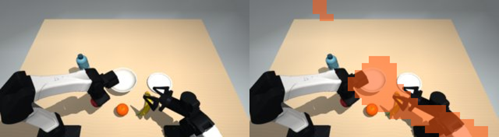

# Nightly Report – 21./22.11.2026

Branch `feature/inference-strategies` (nicht auf `main` gepusht). Alle Läufe mit echtem Dream-1 (`dreamlabs/dream-1-beta`)
im MuJoCo-YAM-Simulator. Rohdaten, Pläne, Logs und Auswertungen liegen in [`measurements/2026-11-22/`](measurements/2026-11-22/),
die vollständigen Kampagnen (jede Zeile ein Trial mit allen Metriken) in `measurements/2026-11-22/campaigns/`.
Umfang: 23 Kampagnen mit 397 Trials (davon 16 gepaarte Strategievergleiche, 14 davon vollständig ausgewertet), dazu Kamera-Selbsttests, Determinismus-Test
und drei X-Ray-Analysen (zusammen ≈ 700 weitere Dream-1-Anfragen), 00:09–07:30 Uhr.

## Kurzfassung

1. **Kamera-Pipeline ist korrekt.** Der neue Kamera-Check (Tab „Cameras“) vergleicht jedes an Dream-1 gesendete Bild
   mit dem gerenderten Wahrheitsbild. Auf echtem Dream-1: 8/8 eingebaute Fehler erkannt (vertauschte Handgelenke,
   doppelte Kamera, kopfüber, BGR, eingefroren, 600 ms Verzögerung, schwarz, Zoom), saubere Läufe ohne Fehlalarm
   (Lag-Median 0 ms, 5,0 fps). Dream-1 nutzt die Kameras: Ausblenden ändert den Plan um bis zu 9,5 cm (overhead) bzw.
   5,9 cm (Handgelenke); wie stark welche Kamera zählt, hängt vom Moment ab (rechtes Handgelenk 0,7–5,6 cm).
2. **Messfehler im Simulator-Loop gefunden und behoben** (künstliche Latenz, V3) – plus zwei weitere Messfehler (V8, V9). Der Dream-Client ersetzte die ersten ~11 Zeilen jedes neuen Chunks durch den alten Plan,
   weil er annimmt, der Roboter laufe während der Anfrage weiter – im Simulator pausiert aber die Physik.
3. **Chunk vs. Crossfade/Receding – klares Ergebnis:** `crossfade-30` schlägt den vollen 48er-Chunk auf identischen
   Szenen in **21 Paaren, der Chunk nur in 3** (55 Paare, McNemar exakt **p ≈ 0,0003**; Δ Fortschritt **+0,35
   [+0,26; +0,44]**). Apfel ungepaart: chunk 12/68 (18 %), crossfade-30 20/40 (50 %). Bestätigt auf frischen Szenen
   (Serie 6: 6/12 vs. 0/12), bei gedimmtem Licht (4/8 vs. 1/8), verschobener Schüssel (5/8 vs. 2/8) und sogar bei der
   Banane, die vorher nie gelang (3/8 vs. 0/7). Der volle Chunk scheitert fast immer **vor dem Greifen** (46 von 68
   Apfel-Trials „nicht gegriffen“). `receding-24` ist ebenfalls besser (+0,30 [+0,19; +0,40], 62 Paare), kurze
   Horizonte (8, 16) und das Ensemble sind gleich oder schlechter. → **Neuer Dashboard-Standard: `crossfade-30`** (V7).
4. **Wichtigste methodische Erkenntnis:** Wiederholungen derselben Szene sind *nicht* identisch – Ursache ist
   GPU-Render-Rauschen (≈0,01 % der Pixel weichen um 1 Graustufe ab). Dream-1 selbst ist deterministisch (gleiche
   Anfrage → identischer Plan), reagiert aber auf dieses unsichtbare Rauschen mit bis zu 0,03 rad im ersten Plan; danach
   divergieren die Läufe chaotisch. Konsequenz: Eine einzelne Szene ist oft ein Münzwurf, deshalb nie anhand einzelner
   Trials optimieren (genau so wurde ausgewertet).
5. **Offene Hauptprobleme:** Die Orange gelingt in keiner Konfiguration (0/50), die Banane nur mit crossfade-30
   (3/8) – sonst rutscht das Objekt aus dem geschlossenen Greifer („slipped“, nicht „released“). Bei crossfade/receding
   ist der dominante Restfehler „neben den Behälter gelegt“.

## Was gebaut wurde (Features auf dem Branch)

| Feature | Dateien | Zweck |
|---|---|---|
| Inferenz-Strategien | `dreamtool/inference.py`, Runner, Dashboard „Execution“ | chunk, receding-N, ensemble-N (ACT-Gewichte), crossfade-N; Greifer immer aus dem neuesten Plan |
| Strategy A/B | `dashboard/extensions/robustness/compare.py` | gepaarter Vergleich auf identischen Szenen: McNemar exakt, Bootstrap-KI, Jitter-Anteil, Seam-Ratio |
| Drop-Analyse | `robustness/monitor.py` | unterscheidet „losgelassen“ (Greifer öffnet) von „rausgerutscht“ |
| Model X-Ray | `dreamtool/xray.py`, Tab „X-Ray“ | geplante Bahnen (FK), Intent-Text, RISE-Heatmaps mit Zufallsniveau, Sprach-Probe |
| Kamera-Check | `dreamtool/camcheck.py`, Tab „Cameras“ | Live-Prüfung jedes gesendeten Bildes, Selbsttest mit 8 Fehlern, „Nutzt Dream-1 die Kamera?“ |
| Retry bei Kapazität | `dreamtool/runner.py` | DA-2000 `pool_full` wird bis 180 s abgewartet statt den Lauf abzubrechen |
| Latenz-Fix | `dreamtool/runner.py` (`latency="paused"`) | siehe V3 |
| Messwerkzeuge | `measurements/analyze.py`, `measurements/pool.py` | Tabellen pro Kampagne / über alle Kampagnen |

Tests: 163 bestanden (`python -m pytest`).

## Methodik

- **Metriken pro Trial:** Erfolg (Simulator-Check), Fortschritt 0–1 (erreicht 0,25 / gegriffen 0,5 / getragen 0,75 /
  abgelegt 1), nächste Annäherung, Endabstand Objekt–Behälter, Zeit bis Erfolg (Simulationszeit), Anzahl Anfragen,
  RTT, Sim- und Wandzeit, Gelenkgeschwindigkeit, Jitter-Anteil (Residuum nach 9-Schritt-Mittel), Seam-Ratio
  (Sprung an Chunk-Grenzen / typischer Schritt), Drops, Ergebnisklasse.
- **Budget:** 40 s Simulationszeit pro Trial (800 Steuerschritte à 50 ms), unabhängig von der Netzwerkzeit.
- **Paarung:** Im Compare-Modus läuft jede Strategie auf exakt derselben Szene (gleicher Seed/gleiche Störung).
  Statistik: McNemar exakt für Erfolg, Bootstrap-KI für Δ Fortschritt, Wilson-KI für Raten.
- **Datenprüfung nach jeder Serie:** `analyze.py` meldet Fehlertrials (z. B. pool_full), unvollständige Paare,
  unplausible Werte. Fehlertrials werden nie als Modellfehler gezählt.
- **Sequenziell:** Nach den `pool_full`-Abbrüchen der ersten Stunde laufen alle Messungen nacheinander in einer Session.

## Experimente und Ergebnisse

### Kamera-Pipeline (Anforderung 4)

| Test | Ergebnis |
|---|---|
| Selbsttest auf echtem Dream-1 (8 Fehler) | 8/8 erkannt, Kamera und Fehlerart korrekt benannt; Verzögerung als 525 ms bzw. 600 ms gemessen |
| Sauberer Lauf | alle drei Kameras „ok“, Match ≥ 0,998, Lag-Median 0 ms, 5,0 fps |
| camera_tilt 0/4/8°, light_dim 0/50/75 %, image_noise 0/10/20 σ, camera_shift 0/4 cm | Pipeline korrekt unter allen Bedingungen (Match ≥ 0,998, Lag 0). Einziger Fehlalarm: „eingefroren“ bei 75 % Dimmung → behoben (V1), Wiederholung 2×0 % und 2×75 %: alles ok |
| Unter Strategien chunk / receding-8 / crossfade-8 | keine Auffälligkeit |
| „Nutzt Dream-1 die Kameras?“ (Apfel, drei Momente) | Ausblenden top 4,13 / 2,88 / 9,45 cm, links 5,87 / 5,94 / 3,50 cm, rechts 1,46 / 5,56 / 0,70 cm, Handgelenke tauschen 2,81 / 6,56 / 2,02 cm. Overhead und linkes Handgelenk (der greifende Arm) zählen immer; das rechte Handgelenk nur in manchen Momenten |

Robustheit des *Modells* gegenüber den Störungen (je 1–2 Trials, nur Hinweise): Kippen der Kamera um 8° und
Verschieben um 4 cm brechen den Apfel-Task, Dimmen und Bildrauschen bis 20 σ nicht eindeutig.

### Serie 1 – Baseline (ohne Latenz-Fix), 3 Prompts × 4 Strategien × 6 Paare

[`series1_baseline_n16.md`](measurements/2026-11-22/series1_baseline_n16.md)

| Prompt | chunk | receding-16 | ensemble-16 | crossfade-16 |
|---|---|---|---|---|
| Apfel → Schüssel | 2/6 | 2/6 | 0/6 | 0/6 |
| Banane → Teller | 0/6 | 0/6 | 0/6 | 0/6 |
| Orange → Teller | 0/5 | 0/5 | 0/4 | 0/4 (Abbruch durch pool_full, Trial nicht gezählt) |

Banane/Orange scheitern fast nur an `carry_failed` (Objekt gehoben, verloren). Crossfade-16 hat den geringsten
Jitter (24–25 % vs. 40–47 %) und die kleinsten Seams, aber keinen Erfolgsvorteil.

### Serie 2 – Chunk-Größen (Apfel, 6 Paare)

[`series2_chunk_sizes.md`](measurements/2026-11-22/series2_chunk_sizes.md): chunk 1/6, receding-8 0/6, receding-24 4/6,
crossfade-8 0/6, crossfade-24 3/6. Δ Fortschritt der 24er-Varianten +0,5 (KI ohne 0). Alle Drops „slipped“.
Befund: receding-8 führte nie einen neuen Plan aus (8 Zeilen < ~11 vom Client ersetzte Zeilen) → führte zu V3.

### Serie 3 – Horizonte 24/30 (8 Paare)

- Apfel ([`series3a`](measurements/2026-11-22/series3a_horizons_apple.md)): chunk 1/8 (7× nicht gegriffen),
  receding-24 2/8, receding-30 3/8, crossfade-30 3/8; Δ Fortschritt +0,375 [+0,12; +0,62] bzw. +0,406 [+0,25; +0,56].
- Orange ([`series3b`](measurements/2026-11-22/series3b_horizons_orange.md)): alle 0/8; Fortschritt chunk 0,38,
  receding-24 0,50 (KI +0,03…+0,25), crossfade-30 0,47, receding-30 0,28.

### Serie 4 – Prompt-Varianten (Apfel, 3 Trials je Variante, ohne Latenz-Fix)

[`series4_prompts.md`](measurements/2026-11-22/series4_prompts.md)

| Prompt | chunk | receding-24 |
|---|---|---|
| put the apple into the bowl | 0/3 | 2/3 |
| place the apple in the bowl | 3/3 | 1/3 |
| could you please pick up the apple and put it into the bowl? | 1/3 | 0/3 |
| apple -> bowl | 0/3 | 0/3 |
| put the red fruit into the bowl | 0/3 | 1/3 |

Keine Variante ist über beide Strategien konsistent besser; „place the apple in the bowl“ 3/3 mit chunk wird in
Serie 6b auf neuen Szenen gegengeprüft. Fortschritt bei receding-24 für alle Prompts ≥ 0,5 (chunk teils 0,25).

### Serie 5 – nach dem Latenz-Fix

- **5a Determinismus** (keine Störung, 4 Wiederholungen derselben Szene, [`series5a`](measurements/2026-11-22/series5a_paused_determinism.md)):
  chunk 1/4, receding-24 1/4, receding-30 2/4, crossfade-30 2/4 – Wiederholungen sind *nicht* identisch. Ursache
  isoliert mit [`determinism.py`](measurements/2026-11-22/determinism.py): gleiche Startpose, gleicher Gelenkzustand,
  aber unterschiedliche Bilder schon bei Anfrage 0 → erster Plan weicht um bis zu 0,029 rad ab, danach bis 0,13 rad
  ([`determinism_render_noise.json`](measurements/2026-11-22/determinism_render_noise.json)). Zwei Renderings desselben
  Zustands unterscheiden sich in 0,001–0,02 % der Pixel um genau 1 Graustufe (GPU-Rasterisierung).
- **5b Horizonte, target_shift 2 cm** (8 Paare, [`series5b`](measurements/2026-11-22/series5b_paused_target_shift.md)):

  | Strategie | Erfolg | Fortschritt | Anfragen | Jitter | Seam/Schritt | häufigster Fehler |
  |---|---|---|---|---|---|---|
  | chunk | 3/8 | 0,50 | 14 | 40 % | 2,70 | nicht gegriffen (4) |
  | receding-8 | 0/8 | 0,31 | 100 | 51 % | 3,28 | geschoben (6) |
  | receding-16 | 0/8 | 0,41 | 50 | 36 % | 2,13 | nicht gegriffen (4) |
  | receding-24 | 2/8 | 0,78 | 31 | 38 % | 1,68 | daneben gelegt (5) |
  | receding-30 | 3/8 | 0,66 | 24 | 40 % | 2,69 | getragen, verloren (2) |
  | crossfade-24 | 2/8 | 0,72 | 31 | 38 % | 1,42 | daneben gelegt (4) |

- **5c gleiche Szenen mit alter Client-Latenz** ([`series5c`](measurements/2026-11-22/series5c_client_target_shift.md)):
  chunk 1/8, receding-16 1/8, receding-24 2/8. Pro Szene gepaart gegen 5b streuen die Ergebnisse in beide Richtungen –
  bei diesem N ist kein Erfolgseffekt des Fixes messbar; der Fix ist trotzdem korrekt, weil er eine nachweislich
  falsche Annahme entfernt (siehe V3) und receding-8/16 erst damit wirklich neue Pläne ausführen.

### Serie 6 – Bestätigung auf neuen Szenen (target_shift 2 cm, Seed 91)

[`series6_confirmation.md`](measurements/2026-11-22/series6_confirmation.md)

| Prompt | Strategie | Erfolg | Fortschritt | Endabstand | häufigster Fehler |
|---|---|---|---|---|---|
| put the apple into the bowl (12 Paare) | chunk | 0/12 | 0,27 | 19,9 cm | nicht gegriffen (10) |
| | receding-24 | 5/12 | 0,67 | 11,9 cm | getragen, verloren (3) / nicht gegriffen (3) |
| | crossfade-30 | **6/12** (McNemar p = 0,03) | 0,77 | 9,2 cm | daneben gelegt (3) |
| place the apple in the bowl (8 Paare) | chunk | 3/8 | 0,53 | 17,8 cm | nicht gegriffen (5) |
| | receding-24 | 2/8 | 0,62 | 11,2 cm | getragen, verloren (4) |

Die 3/3 von „place the apple in the bowl“ aus Serie 4 bestätigen sich auf neuen Szenen nicht (3/8) – ein Effekt
einer einzelnen Szene, kein Prompt-Effekt.

### Serie 7 – der neue Standard unter anderen Bedingungen (8 Paare je Bedingung)

[`series7_default_conditions.md`](measurements/2026-11-22/series7_default_conditions.md)

| Bedingung | chunk | crossfade-30 | Fortschritt chunk → crossfade-30 |
|---|---|---|---|
| Apfel, Licht 50 % gedimmt | 1/8 | **4/8** | 0,41 → 0,84 |
| Apfel, Schüssel 3 cm verschoben | 2/8 | **5/8** | 0,56 → 0,88 |
| Banane → Teller, target_shift 2 cm | 0/7 (1 Trial nicht gewertet, V9) | **3/8** | 0,46 → 0,69 |

Gepoolt über die drei Bedingungen: 12:3 diskordante Paare, McNemar p = 0,035, Δ Fortschritt +0,34 [+0,18; +0,48].

### Über die ganze Nacht gepoolt

[`pooled_all_night.md`](measurements/2026-11-22/pooled_all_night.md) (alle 14 Compare-Kampagnen, gepaart nur gleiche
Szene/gleicher Prompt; nicht gewertete Trials ausgeschlossen):

| Strategie | Paare | Erfolg chunk | Erfolg Strategie | nur chunk | nur Strategie | McNemar p | Δ Fortschritt (95 %-KI) |
|---|---|---|---|---|---|---|---|
| **crossfade-30** | 55 | 9 % | 42 % | 3 | 21 | **0,0003** | **+0,35 [+0,26; +0,44]** |
| crossfade-24 | 14 | 29 % | 36 % | 2 | 3 | 1,00 | +0,34 [+0,16; +0,52] |
| receding-24 | 62 | 16 % | 29 % | 8 | 16 | 0,15 | +0,30 [+0,19; +0,40] |
| receding-30 | 28 | 18 % | 29 % | 3 | 6 | 0,51 | +0,18 [+0,03; +0,33] |
| receding-16 | 33 | 18 % | 9 % | 6 | 3 | 0,51 | +0,02 [−0,12; +0,15] |
| crossfade-16 | 16 | 12 % | 0 % | 2 | 0 | 0,50 | −0,05 [−0,20; +0,09] |
| ensemble-16 | 16 | 12 % | 0 % | 2 | 0 | 0,50 | −0,09 [−0,20; 0,00] |
| receding-8 | 14 | 29 % | 0 % | 4 | 0 | 0,13 | −0,20 [−0,41; 0,00] |

Ungepaart, Apfel: chunk 12/68 (18 %, davon 46× nicht gegriffen), crossfade-30 20/40 (50 %), receding-24 16/46 (35 %),
receding-30 8/20 (40 %). Warum hilft es? Der volle Chunk fährt 2,4 s blind – genau in der Annäherung an das Objekt,
wo eine Korrektur nötig wäre. crossfade-30 plant nach 1,5 s neu und blendet ohne Sprung über (Seam/Schritt 1,1–1,2
statt 2,7–2,9).


### Model X-Ray auf echtem Dream-1

[`xray_real/`](measurements/2026-11-22/xray_real/), Moment bei 78 s (Apfel):

- Dream-1 ist deterministisch: drei identische Anfragen → 0,0 cm Streuung, Ziel immer „apple“.
- Der neu erfragte Plan weicht 2,31 cm vom aufgezeichneten ab (Seam-Glättung des Clients).
- Sprach-Probe: folgt dem Objektwort in 1 von 4 Fällen – der Moment war aber zu spät (Arm schon am Apfel), daher
  V4. Mit dem Kunstwort „blicket“ geht es trotzdem zum Apfel.
- RISE (60 Masken): nur die Overhead-Kamera knapp über Zufallsniveau (0,57 vs. 0,56 cm) → 60 Masken reichen nicht.
- Ganze Kamera ausblenden: top 5,04, links 4,47, rechts 2,81 cm Planänderung.

Wiederholung nach V4/V8 ([`log_xray2.jsonl`](measurements/2026-11-22/log_xray2.jsonl),
[`log_xray3.jsonl`](measurements/2026-11-22/log_xray3.jsonl), Ergebnisse in `xray_real/`):

| Moment | Re-Ask vs. Aufzeichnung | Kamera ausblenden (top/links/rechts) | RISE | Sprach-Probe |
|---|---|---|---|---|
| 3,0 s (Arm fährt Richtung Apfel) | 5,86 cm, Ziel geht verloren | 0,50 / 0,47 / 0,42 cm | 200 Masken, alles auf Zufallsniveau (206 Aufrufe) → **V8**: jetzt übersprungen nach 6 Aufrufen, mit Begründung (auf Dream-1 bestätigt) | kein Ziel im Plan → nicht prüfbar |
| 4,5 s (schließt Greifer 5,7 cm vom Apfel) | 2,68 cm, Ziel geht verloren | 4,06 / 5,29 / 1,47 cm | 200 Masken, Peaks 0,46–0,66 cm unter Zufallsniveau 0,69–0,71 cm | kein Ziel im Plan → nicht prüfbar |

Erkenntnisse:
- Dream-1 ist bei identischer Anfrage weiterhin exakt deterministisch (Rauschen 0,0 cm in allen Läufen).
- Der neu erfragte Plan weicht systematisch 2,3–5,9 cm vom aufgezeichneten ab. Ursache: Im Live-Lauf glättet der
  Client jeden Chunk auf den vorherigen Plan (Savitzky-Golay + 16-Zeilen-Übergang), die X-Ray-Session beginnt ohne
  Vorplan. Die X-Ray-Vergleiche (Masken, Wörter) sind untereinander konsistent, weil alle gegen denselben Re-Ask
  gemessen werden – aber die Ziel-Erkennung kippt dadurch bei knappen Momenten.
- Ganze Kameras ausblenden ist aussagekräftig (bis 9,5 cm), RISE mit gleichzeitigen Masken auf allen drei Kameras
  nicht: jede Maske verdeckt die Hälfte *jeder* Kamera, der Effekt einzelner Zellen geht im Gesamteffekt unter.

Nachmessung nach V10/V11 (morgens, [`log_xray4.jsonl`](measurements/2026-11-22/log_xray4.jsonl),
`xray_real/results_*_v2.json`), dieselben zwei Momente:

| Moment | RISE, nur meistgenutzte Kamera, 200 Masken (¼ verdeckt) | Sprach-Probe (Annäherung an das genannte Objekt vs. Original-Prompt) |
|---|---|---|
| 78 s, Greifer am Apfel | Overhead: Peak 0,61 cm, Zufallsniveau 0,39 cm → **über Zufall** (vorher mit allen Kameras: 0,57 vs. 0,56) | Banane −0,0 cm, Orange −0,5 cm, Flasche +0,2 cm → **0 von 3**: ignoriert das Wort, bleibt beim Apfel |
| 4,5 s, schließt 5,7 cm vor dem Apfel | linkes Handgelenk: 0,58 vs. 0,58 → genau auf Zufallsniveau | Banane −0,1 cm, Orange −0,2 cm, Flasche −1,3 cm → **0 von 3** |



Die Heatmap (rechts, orange = Verdecken ändert den Plan mehr als Zufall) liegt vor allem auf der **Schüssel** – dem Ziel
des nächsten Schritts, denn der linke Greifer ist bereits am Apfel – und auf der Greiferspitze; dazu ein Band entlang des
rechten Arms und ein kleiner Fleck im Hintergrund (vermutlich Zufall). Erstmals ein plausibles RISE-Signal auf echtem
Dream-1. Die Sprach-Probe gibt jetzt eine Antwort statt „nicht prüfbar“: Kurz vor und während des Griffs entscheidet
das Bild, nicht das Wort. Ob Dream-1 das Wort *früher* in der Annäherung nutzt, ist noch offen (Problem 6).

## Verbesserungen (jeweils durch eine Messung begründet und erneut gemessen)

| # | Schwachpunkt (Messung) | Änderung | Nachmessung |
|---|---|---|---|
| V1 | Kamera-Check meldete „eingefroren“ bei 75 % Dimmung, fps falsch | Graustufen-Änderung beider Seiten vergleichen; fps aus benachbarten Frames | 2×0 % + 2×75 % ohne Fehlalarm; Selbsttest erkennt eingefroren/Verzögerung/schwarz weiterhin; Regressionstest `test_dark_slow_scene_is_not_called_frozen` |
| V2 | Parallel laufende Messungen brachen mit DA-2000 `pool_full` ab (Serie 1 Orange bei 18/24) | Runner wartet retrybare Ablehnungen bis 180 s ab; X-Ray/Kamera-Tests mit einer Session; Messungen sequenziell | danach keine Fehlertrials mehr (ein Orange-Start um 01:20 brach vor dem Fix nach 1 Trial ab und wurde als `20261122-014508-compare` wiederholt) |
| V3 | receding-8 führte nie einen neuen Plan aus; Trial-Varianz hing von der RTT ab | `latency="paused"`: der Client bekommt `action_hz = 1e-3`, damit `round(rtt · hz) = 0` Zeilen ersetzt werden – im pausierenden Simulator die Wahrheit. `"client"` bleibt für alte Läufe/Vergleich wählbar | Serie 5b/5c; Unit-Test mit `dream.smoothing.old_motion`; alte Ergebnisse tragen im Report „· client latency“ |
| V4 | Sprach-Probe auf einem zu späten Moment | X-Ray behält die ersten 6 Momente eines Laufs (`FIRST_MOMENTS`) statt nur der letzten | siehe X-Ray-Wiederholung |
| V5 | Greifer-Blend > 1 und Blend des Greifers verzögert das Schließen | Greifer immer aus dem neuesten Plan, nur Armgelenke werden geblendet | Unit-Tests |
| V6 | Jerk-Index bevorzugte langsame Strategien | Jitter-Anteil (Residuum nach gleitendem Mittel) statt Jerk für „smoothest“ | Serie 1 ff. |
| V7 | Voller Chunk scheitert meist vor dem Greifen; crossfade-30 signifikant besser (Serien 1–6) | Dashboard-Standard `inference.DEFAULT = "crossfade-30"`, Menü nach Messung sortiert, 8er/16er-Varianten aus dem Menü (per Name weiter nutzbar); `run_task()` behält `chunk` | Serie 7 unter drei neuen Bedingungen: jeweils besser, gepoolt p = 0,035 |
| V8 | RISE auf einem Moment, an dem der Plan kaum von den Bildern abhängt: 200 Masken (206 API-Aufrufe), alles auf Zufallsniveau | RISE fragt zuerst unverändert + je Kamera ausgeblendet; ändert das den Plan um ≤ max(3 × Rauschen, 1 cm), werden die Masken übersprungen und der Grund angezeigt | Unit-Test; Nachmessung auf Dream-1 siehe X-Ray |
| V10 | RISE mit Masken auf allen drei Kameras: auf Dream-1 auch mit 200 Masken kein Signal | Masken nur auf der Kamera, deren Ausblenden den Plan am stärksten ändert (die anderen bleiben unverändert), ¼ statt ½ verdeckt; `camera="all"` hält den alten Weg | 78 s: über Zufallsniveau, Schüssel und Greifer markiert; 4,5 s: auf Zufallsniveau |
| V11 | Sprach-Probe: harte Ziel-Erkennung (Greifen ≤ 8 cm) fehlte im neu erfragten Plan in 2 von 3 Momenten → „nicht prüfbar“ | Original-Prompt wird mitgefragt; pro Wort zählt, wie viel näher die Greiferbahn dem genannten Objekt kommt – mehr als max(3 × Rauschen, 1 cm) und mehr als jedem anderen Objekt | beide Momente liefern eine Antwort (0 von 3); Unit-Test mit synthetischen Abständen |
| V9 | Ein Chunk-Trial endete nach 240 von 800 Schritten, weil Anfragen ~14 min hingen (Rechner im Standby), und wurde als „nicht gegriffen“ gezählt (Datenprüfung: RTT 854 s) | Bei Simulationsbudget heißt ein Abbruch durch die Wanduhr jetzt `wall_timeout` → Ergebnis „aborted“, nie gewertet; `analyze.py` erkennt alte Fälle (timeout mit weniger Schritten als Budget) | in der ganzen Nacht genau dieser eine Trial betroffen; Serie 7 neu ausgewertet |

## Offene Probleme

1. **Orange 0/50, Banane nur mit crossfade-30 (3/8, sonst 0/31):** Das Objekt rutscht aus dem geschlossenen Greifer
   (Drop-Analyse: „slipped“, Greifer bleibt zu). Vermutlich Kontakt-/Reibungsparameter der Objekte oder die
   Greifposition – kein reines Inferenzproblem.
2. **„Daneben gelegt“** ist mit crossfade-30/receding-24 der häufigste Restfehler (Apfel: 11/40 bzw. 15/46).
3. **receding-24 vs. crossfade-30 direkt** wurde nur in Serie 6 verglichen (5/12 vs. 6/12) – welcher der beiden
   besser ist, ist offen; beide sind klar besser als der volle Chunk.
4. **Render-Rauschen:** Für exakt reproduzierbare Wiederholungen müsste das Rendering deterministisch gemacht werden
   (CPU-Renderer/OSMesa oder Rundung vor dem JPEG). Bewusst nicht umgesetzt: das Rauschen wirkt wie echtes
   Sensorrauschen und macht Wiederholungen zu echten Stichproben.
5. **RISE** zeigt jetzt in einem von zwei Momenten ein Signal; bei kleinen Planänderungen (linkes Handgelenk, 4,5 s)
   reichen 200 Masken nicht. Ein Lauf kostet ~200 Aufrufe; mehr Masken oder ein gröberes Raster wären der nächste Schritt.
6. **Sprach-Probe** wurde nur an Momenten nahe am Apfel gemessen (0 von 3). Offen ist, ob Dream-1 das Objektwort am
   *Anfang* der Annäherung nutzt – dafür einen Moment mit großem Abstand zu allen Objekten einfrieren. Eine echte
   Live-Anwärmung (der Plan vor dem Moment als Ausgangspunkt der Client-Glättung) bräuchte den vorherigen Plan im
   Snapshot; der Re-Ask weicht deshalb weiter 2,3–5,9 cm vom aufgezeichneten Plan ab.
7. **Dream Input-Check:** Der Client warnt „no one has checked what the model sees …“. Die Aufzeichnung per
   `python -m dream.input_check` ist laut Dream einer Person vorbehalten („never an agent“) – bitte selbst ausführen.
   Der Kamera-Check liefert dafür die Belege.
8. Moritz’ Node-Test im Test-Suite-Bereich schlägt weiterhin fehl (bestand schon vor dieser Nacht).

## Reproduzieren

```
python measurements/analyze.py <out.md> <campaign id> ...
python measurements/pool.py <out.md> <campaign id> ...
python measurements/2026-11-22/drive.py 8001 measurements/2026-11-22/plan6.json log.jsonl   # Dashboard auf Port 8001
```

Kampagnen-IDs stehen in den `log*.jsonl` und in jeder Tabelle.
